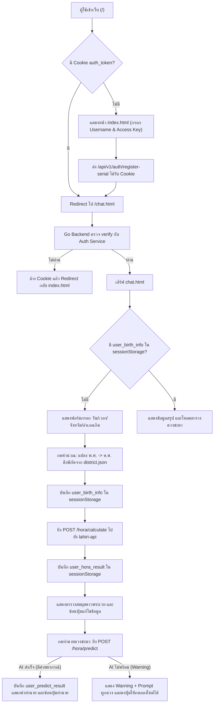

# Project Context: ssr-web (บูมบามเอไอ พยากรณ์)

## 1. ภาพรวมโปรเจกต์ (Project Overview)
โปรเจกต์ **`ssr-web`** ทำหน้าที่เป็น **BFF (Backend-For-Frontend)** และ **SSR Gateway** เขียนด้วยภาษา **Go (Golang)** สำหรับระบบทำนายดวงชะตาโหราศาสตร์พระเวท ("บูมบามเอไอ พยากรณ์")
- **ความรับผิดชอบหลัก**:
  1. เสิร์ฟหน้าเว็บหลักและไฟล์ Static ผ่านหน่วยความจำ (RAM) ด้วย `embed.FS`
  2. ตรวจสอบสิทธิ์ผู้ใช้ (Authentication Cookie: `auth_token`) กับ Auth Microservice ก่อนให้เข้าถึงหน้าห้องพยากรณ์ (`/chat.html`)
  3. เป็น Proxy รับคำขอคำนวณดวงชะตาจากหน้าบ้าน ส่งต่อไปยัง `lahiri-api` (พอร์ต 8083) และส่งผลลัพธ์ภาษาไทยกลับไปแสดงผล
  4. บริหารจัดการข้อมูลผู้ใช้แบบเป็นส่วนตัวสูง (Zero-Persistence Privacy) ด้วย `sessionStorage`

---

## 2. สถาปัตยกรรมและการออกแบบ (Architecture & Principles)

### 2.1 Standard Go Project Layout
โครงสร้างโปรเจกต์จัดระเบียบตามมาตรฐาน Go อย่างเคร่งครัด:
- `cmd/server/main.go`: Entry point ตั้งค่า Daily Log Rotation, Config, Routes, Middleware, และ HTTP Server พร้อม Timeouts
- `internal/config/config.go`: โหลดค่า Environment Variable จากไฟล์ `.env` พร้อมตั้งค่า Default
- `internal/logger/logger.go`: ระบบ Daily Log Rotation หมุนไฟล์อัตโนมัติทุกวันลง `logs/app-YYYY-MM-DD.log` พร้อมเขียนออก Console และลบไฟล์เก่าเกิน 7 วัน
- `internal/handler/`: Business Logic และ HTTP Handlers แยกเป็นโมดูลชัดเจน
  - `handler.go`: SSR Routing, Auth Verification, Static/Public Serving
  - `hora.go`: Proxy ไปยัง `lahiri-api` (`/api/v1/hora/calculate`, `/hora/calculate`, `/hora/dasha`, `/hora/predict`, `/hora/transitpredict_1`..`12`) พร้อมระบบจำกัดขนาด Body 1 MB (`http.MaxBytesReader`)
  - `middleware.go`: Logging Middleware บันทึก Method, Path, Status Code, Bytes, Latency, Cookie, Remote IP พร้อมทำความสะอาด CRLF ป้องกัน Log Injection
  - `handler_test.go`: Unit Tests และ Parallel Load Benchmarks
- `web/`: ไฟล์ฝั่งหน้าบ้านที่ถูกฝังลงใน Binary ด้วย `embed.FS`
  - `index.html`, `chat.html`, `transit.html`
  - `static/`: `auth.js`, `hora-common.js` (ฟังก์ชันแปลง Markdown กลาง `renderMarkdown`), `birth.js`, `astrology.js`, `transit.js`, `district.js`, `district.json` และ Templates
- `public/`: ไฟล์รูปภาพบน Disk ที่ไม่อยู่ใน Binary

### 2.2 สถาปัตยกรรมไฮบริดสำหรับไฟล์ Static (Hybrid Asset Model)
- **Embedded Assets (`web/` ผ่าน `embed.FS`)**:
  - ฝังไฟล์ `index.html`, `chat.html`, `static/*.js`, `district.json`, `result-template.html` เข้าสู่ RAM ของ Binary
  - ให้ความเร็วสูงสุดระดับไมโครวินาที (Microseconds) และไม่ติด System Call ในการอ่านไฟล์โค้ด
- **Disk Assets (`public/` ผ่าน `http.Dir`)**:
  - เสิร์ฟรูปภาพขนาดใหญ่ เช่น `favicon.png`, `avatar.jpg` จากโฟลเดอร์ `public/` บน Disk โดยตรง
  - ป้องกันปัญหาไฟล์ Binary บวม และสามารถเปลี่ยนรูปภาพได้ทันทีโดยไม่ต้อง Compile โปรแกรมใหม่

### 2.3 ความปลอดภัยและความเป็นส่วนตัว (Security & Privacy)
- **HttpOnly Cookie**: ส่งและตรวจสอบ Cookie `auth_token` ผ่าน Backend โดยเบราว์เซอร์ไม่สามารถเข้าถึง Token โดยตรงได้
- **Session-Only Storage**: ชื่อผู้ใช้ (`user_username`), ข้อมูลวันเกิด (`user_birth_info`), ผลลัพธ์คำนวณดาว (`user_hora_result`) และผลลัพธ์คำทำนาย (`user_predict_result`) จัดเก็บใน `sessionStorage` เท่านั้น เมื่อปิดแท็บหรือเบราว์เซอร์ ข้อมูลจะถูกลบทันที
- **Validation & Locking State**:
  - หน้า Login บังคับชื่อผู้ใช้เป็นตัวอักษรโรมันหรือตัวเลขเท่านั้น (`/^[A-Za-z0-9]+$/`)
  - หน้าคำนวณบังคับปี พ.ศ. ตั้งแต่ 2500 ขึ้นไป
  - ซ่อนปุ่มแก้ไขข้อมูลวันเกิดทันทีที่คำนวณตำแหน่งดาวสำเร็จ
  - ซ่อนปุ่มทำนายดวงชะตา (AI Predict) ทันทีที่พยากรณ์พื้นดวงชะตาสำเร็จและบันทึกลง `sessionStorage` แล้ว
- **DOM XSS Prevention & Template Isolation**:
  - แยกโครงสร้าง HTML ออกจากไฟล์ JS ไว้ใน `result-template.html` และ `astrology-template.html`
  - ห้ามเขียนผลลัพธ์จาก `fetch()` ลง `innerHTML` โดยตรง ต้องแปลงผ่าน `DOMParser` คัดกรองแท็กอันตรายออก และใช้ `replaceChildren` / `document.importNode` หรือผูกข้อมูลด้วย `textContent` เสมอ

### 2.4 Nginx Upstream และระบบ Log Rotation
- **Nginx Upstream บน Windows**: ต้องใช้ `proxy_pass http://127.0.0.1:8081/;` เสมอ ห้ามใช้ `localhost` เพื่อป้องกันปัญหา IPv6 `[::1]` Timeout (Error 10060) นาน 21 วินาที
- **Daily Log Rotation (`internal/logger`)**: บันทึก Log รายวันลง `logs/app-YYYY-MM-DD.log` แบบ Dual Output (Console + File) และลบไฟล์สำรองเก่าเกิน 7 วันอัตโนมัติ

---

## 3. โครงสร้างไฟล์ในโปรเจกต์ (Directory Map)

```text
ssr-web/
├── .agents/
│   └── rules/
│       └── project-context.md   # กฎและบริบทโปรเจกต์สำหรับ AI Assistant
├── cmd/
│   └── server/
│       └── main.go              # Entrypoint สำหรับเริ่มต้น HTTP Server
├── internal/
│   ├── config/
│   │   └── config.go            # โหลดค่าจาก .env และ Default settings
│   ├── logger/
│   │   ├── logger.go            # Daily Log Rotation (Console + File) และลบไฟล์เก่าเกิน 7 วัน
│   │   └── logger_test.go       # Unit Tests สำหรับตรวจสอบการหมุนไฟล์และลบ Log เก่า
│   └── handler/
│       ├── handler.go           # Handlers สำหรับ SSR, Auth Check, Cookie Management
│       ├── hora.go              # Proxy Service เชื่อมต่อไปยัง lahiri-api
│       ├── middleware.go        # HTTP Logging Middleware
│       └── handler_test.go      # Unit & Benchmark Tests
├── public/                      # [Disk Asset] รูปภาพและ Favicon
│   ├── favicon.png              # ไอคอนเว็บ 64x64
│   └── avatar.jpg               # รูปโปรไฟล์/รูปภาพประกอบ
├── web/                         # [Embedded Asset] หน้าเว็บและสคริปต์
│   ├── embed.go                 # ประกาศ //go:embed ฝังไฟล์เข้า Binary
│   ├── index.html               # หน้าลงทะเบียน/ยืนยัน Access Key
│   ├── chat.html                # หน้าหลักสำหรับคำนวณดวงและห้องแชท
│   └── static/
│       ├── astrology.js         # เรียก API คำนวณดาว และ Render ตารางพระเวท (เติมค่าลง Template)
│       ├── astrology-template.html # <template> ตารางสมผุสดาวและแถวดาว (แยก HTML ออกจาก JS)
│       ├── auth.js              # ตรวจสอบสิทธิ์และออกจากระบบ
│       ├── birth.js             # รับค่าวันเกิด แปลง พ.ศ./ค.ศ. และหาพิกัด
│       ├── district.js          # โหลดข้อมูลจังหวัดและอำเภอ
│       ├── district.json        # ฐานข้อมูลพิกัด ละติจูด/ลองจิจูด ทั่วไทย
│       └── result-template.html # Template แสดงผลสรุปวันเกิดและผลลัพธ์
├── .env                         # การตั้งค่าสภาพแวดล้อม (Port, Service URLs)
├── .gitignore                   # กำหนดไฟล์ที่ไม่ติดตามขึ้น Git (รวม ssr-web binary)
├── GEMINI.md                    # คู่มือบริบทโปรเจกต์
├── go.mod                       # Go module definition
├── go.sum                       # Go dependencies checksum
├── LICENSE                      # สิทธิ์การใช้งาน
└── run.sh                       # Bash Script สำหรับรัน/Build/ทดสอบบน WSL/Ubuntu
```

---

## 4. การตั้งค่าระบบ (Configuration & Environment Variables)

กำหนดในไฟล์ `.env` ที่ Root Directory:

| ตัวแปร | ค่าเริ่มต้น | คำอธิบาย |
| :--- | :--- | :--- |
| `PORT` | `8081` (fallback `6666`) | พอร์ตที่ `ssr-web` ให้บริการ |
| `AUTH_SERVICE_URL` | `http://localhost:8082` (fallback `7777`) | URL ของ Authentication Microservice |
| `HORA_SERVICE_URL` | `http://localhost:8083` | URL ของ Lahiri Vedic Astrology API |

---

## 5. เส้นทาง API และ Routing (Endpoints)

### 5.1 SSR Routes
- `GET /` หรือ `GET /index.html`:
  - ถ้ามี Cookie `auth_token` ➔ Redirect ไป `/chat.html` (สถานะ 303)
  - ถ้าไม่มี ➔ เสิร์ฟหน้า `index.html`
- `GET /chat.html`:
  - ตรวจสอบ `auth_token` กับ `$AUTH_SERVICE_URL/api/v1/auth/verify`
  - หากไม่มี Cookie หรือไม่ผ่าน ➔ ล้าง Cookie และ Redirect ไป `/index.html`
  - หากผ่าน ➔ เสิร์ฟหน้า `chat.html`

### 5.2 API Proxy Routes
- `POST /hora/calculate` และ `POST /api/v1/hora/calculate`:
  - ส่งต่อคำขอคำนวณดวงชะตาเต็มรูปแบบไปยัง `$HORA_SERVICE_URL/api/v1/hora/calculate`
  - รองรับ Whole Sign (W), ละติจูด/ลองจิจูด, เวลาไทย (hour_thai)
- `POST /hora/dasha` และ `POST /api/v1/hora/dasha`:
  - ส่งต่อคำขอคำนวณวิมโสตรีทศาไปยัง `$HORA_SERVICE_URL/api/v1/hora/dasha`
- `POST /hora/predict` และ `POST /api/v1/hora/predict`:
  - ส่งต่อคำขอทำนายดวงชะตาไปยัง `$HORA_SERVICE_URL/api/v1/hora/predict`
  - รองรับผลลัพธ์ทั้งกรณี AI สำเร็จ (คำพยากรณ์ Markdown) และกรณีระบบ AI ไม่พร้อมใช้งาน (Warning + ข้อมูล Prompt)

### 5.3 Static & Public Assets
- `GET /static/*`: เสิร์ฟไฟล์จาก `embed.FS` (`web/static/`)
- `GET /public/*`: เสิร์ฟไฟล์จาก Disk (`public/`)
- `GET /favicon.ico`: ชี้ไปยังไฟล์ `public/favicon.png`

---

## 6. วงรอบการทำงานฝั่ง Frontend (Frontend Workflow)



---

## 7. คำสั่งที่ใช้ในการพัฒนาและการทดสอบ (Commands & Operations)

### การทำงานบน WSL / Linux (ผ่าน `run.sh`)
```bash
# ให้สิทธิ์รันครั้งแรก
chmod +x run.sh

# 1. Build และรัน Binary ทันที (โหมดปกติสำหรับ Production/Testing)
./run.sh

# 2. รันในโหมดพัฒนาผ่าน go run
./run.sh dev

# 3. Build เฉพาะไฟล์ Binary (./ssr-web)
./run.sh build

# 4. รัน Unit Tests และ Parallel Benchmark วัดความเร็ว
./run.sh bench
```

### การทดสอบด้วย Go CLI โดยตรง
```bash
# รัน Unit Tests ทั้งหมด
go test -v ./internal/handler

# รัน Benchmark วัดความเร็วและ Allocation หน่วยความจำ
go test -v -bench=. -benchmem ./internal/handler
```

---

## 8. ข้อตกลงและแนวทางปฏิบัติสำหรับการพัฒนาต่อยอด (Developer Guidelines)
1. **การแก้ไขไฟล์ใน `web/`**:
   - เมื่อแก้ไข HTML, JS หรือ JSON ใน `web/` **จะต้องสั่ง Build ใหม่เสมอ** (เช่น `./run.sh` หรือ `go build`) เพราะไฟล์ถูกฝังใน `embed.FS`
   - เมื่ออัปเดตสคริปต์ใน `web/static/` ให้เปลี่ยนเลข Version Query String ใน `web/chat.html` (เช่น `?v=YYYYMMDDXX`) เพื่อป้องกันแคชเบราว์เซอร์
2. **การเพิ่มรูปภาพหรือสื่อมวลชน**:
   - ห้ามนำรูปภาพขนาดใหญ่ไปใส่ใน `web/` ให้ใส่ไว้ในโฟลเดอร์ `public/` บน Disk เท่านั้น เพื่อรักษาขนาด Binary ให้เล็กและรวดเร็ว
3. **การรักษาความเข้ากันได้ของระบบคำนวณ**:
   - รักษาโครงสร้าง `calculateReq` และ `calculateResp` ให้สอดคล้องกับ `lahiri-api`
   - คงการแปลงปี พ.ศ. เป็น ค.ศ. สำหรับส่งให้ API ดาราศาสตร์สวิส (Swiss Ephemeris)
4. **Line Endings**:
   - ไฟล์สคริปต์ Shell (`run.sh`) ต้องบันทึกด้วยรูปแบบบรรทัด **LF (Unix)** เสมอ ห้ามเป็น CRLF
