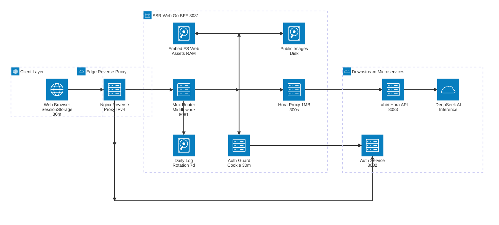

# สถาปัตยกรรมระบบระดับสูง (High-Level Architecture) — ssr-web Ecosystem

เอกสารนี้อธิบายสถาปัตยกรรมระดับสูงของระบบ **บูมบามเอไอ พยากรณ์ (`ssr-web`)** ในฐานะ **BFF (Backend-For-Frontend)** และ **SSR Gateway** รวมถึงการทำงานร่วมกับ Reverse Proxy และ Microservices ภายนอกที่เกี่ยวข้องทั้งหมด

---

## 1. แผนภาพสถาปัตยกรรม (Mermaid `architecture-beta`)

---

## 2. บทบาทและรายละเอียดของแต่ละ Service และ Component

### 2.1 Client Layer (`Web Browser`)
* **หน้าที่หลัก**: แสดงผลหน้าเว็บ SSR (`index.html`, `chat.html`, `transit.html`) และทำงานร่วมกับไฟล์ JavaScript ใน `web/static/`
* **Zero-Persistence Privacy (`sessionStorage` 30 นาที)**:
  * ข้อมูลส่วนตัวผู้ใช้ (`user_username`, `user_birth_info`, `user_hora_result`, `user_predict_result`, `user_transit_2570`) และ `user_session_expires_at` ถูกจัดเก็บเฉพาะใน `sessionStorage` เท่านั้น (ไม่ใช้ `localStorage` หรือฐานข้อมูลถาวรฝั่ง Client)
  * `web/static/login.js` และ `web/static/auth.js` ควบคุมอายุข้อมูลให้ครบ **30 นาที (`1,800,000 ms`)** ด้วยตัวจับเวลา `setTimeout` และตรวจสอบซ้ำเมื่อหน้าต่างกลับมาโฟกัส (`visibilitychange`, `focus`, `pageshow`) เมื่อหมดเวลาหรือปิดแท็บ ข้อมูลจะถูกล้างทิ้งและเรียก `POST /api/v1/auth/logout` พร้อมพาไป `/index.html?expired=1`
* **DOM XSS Prevention & Markdown**:
  * โหลด HTML Templates (`result-template.html`, `astrology-template.html`, `transit-template.html`) ผ่าน `DOMParser` และผูกข้อมูลผ่าน `textContent` (`fillFields()`)
  * ประมวลผลคำทำนาย Markdown ผ่าน `renderMarkdown()` ใน `web/static/hora-common.js` แบบ Linear Scan `O(n)` โดยไม่พึ่งพา CDN ภายนอก

---

### 2.2 Edge Reverse Proxy Layer (`Nginx`)
* **หน้าที่หลัก**: รับทราฟฟิกจากผู้ใช้งานปลายทางแล้วส่งต่อ (Proxy) ไปยังบริการภายในตาม Path:
  * ส่งหน้าเว็บ SSR, Static Files และคำขอ `/hora/*` ไปยัง `ssr-web` (`http://127.0.0.1:8081/`)
  * ส่งคำขอ `/api/` (เช่น `/api/v1/auth/register-serial`, `/api/v1/auth/verify`, `/api/v1/auth/logout`) ไปยัง `Auth Service` (`http://127.0.0.1:8082/api/`)
* **ข้อกำหนดสำคัญบน Windows (`IPv4 Only`)**:
  * ต้องใช้ `127.0.0.1` แทน `localhost` ใน `proxy_pass` เสมอ เพื่อป้องกัน Nginx พยายามเชื่อมต่อไปยัง IPv6 `[::1]` ก่อนจนเกิด TCP Timeout (`WSAETIMEDOUT 10060`) นาน 21 วินาทีต่อ Request

---

### 2.3 Application / BFF Layer (`ssr-web` — Go Server `:8081`)

| โมดูล / องค์ประกอบ | ไฟล์ต้นทาง | หน้าที่และความรับผิดชอบ |
| :--- | :--- | :--- |
| **HTTP Server & Config** | `cmd/server/main.go`, `internal/config/config.go` | โหลดค่า `.env` (`PORT=8081`, `AUTH_SERVICE_URL`, `HORA_SERVICE_URL`) และตั้งค่า `ReadTimeout: 30s`, `WriteTimeout: 360s`, `IdleTimeout: 120s` |
| **Mux Router & Middleware** | `internal/handler/handler.go`, `internal/handler/middleware.go` | กระจาย Route SSR/Proxy, ตั้ง Header `Cache-Control: no-store` สำหรับไฟล์ `.js` และบันทึก Request Log พร้อมตัดอักขระ `\r\n` (`sanitizeLogString`) ป้องกัน Log Injection (CWE-117) |
| **Auth Guard & Cookie 30m** | `internal/handler/auth.go` | ตรวจสอบ Cookie `auth_token` กับ `AUTH_SERVICE_URL/api/v1/auth/verify` (Timeout `5s`) ก่อนเสิร์ฟ `/chat.html` และ `/transit.html`, ออกและบังคับใช้ Cookie `ssr_session_exp` (`Max-Age=1800`, `HttpOnly`, `Secure`, `SameSite=Lax`) และ Proxy เส้นทาง `/api/v1/auth/serial-keys`, `/auth/serial-keys` |
| **Hora Proxy** | `internal/handler/hora.go` | รับคำขอ `POST` สำหรับ `/api/v1/hora/*` และ `/hora/*` (`calculate`, `dasha`, `predict`, `transitpredict_1`..`12`), จำกัดขนาด Request Body สูงสุด **1 MB** (`http.MaxBytesReader`), ตรวจสอบอายุ `ssr_session_exp` (คืน `401` หากหมดอายุ) และตั้ง Context Timeout **`300s`** |
| **Embedded Web Assets (`embed.FS`)** | `web/embed.go`, `web/` | ฝังไฟล์ HTML, JS, Templates และฐานข้อมูลพิกัดอำเภอ/จังหวัด (`district.json`) ไว้ใน Binary เสิร์ฟจาก RAM ระดับไมโครวินาที (ต้อง Rebuild Binary ทุกครั้งที่แก้ไฟล์ใน `web/`) |
| **Public Disk Assets** | `public/` | เสิร์ฟไฟล์รูปภาพ (`favicon.png`, `avatar.jpg`) จาก Disk โดยตรง เพื่อไม่ให้ Binary บวมและเปลี่ยนรูปได้ทันทีโดยไม่ต้อง Build ใหม่ |
| **Daily Log Rotation** | `internal/logger/logger.go` | เขียน Log แบบ Dual Output (Console + ไฟล์ `logs/app-YYYY-MM-DD.log`) หมุนไฟล์อัตโนมัติทุกวัน และลบไฟล์เก่าเกิน **7 วัน** ในพื้นหลัง |

---

### 2.4 Downstream Microservices Layer

| Service | ค่าเริ่มต้น URL | บทบาทและการทำงานร่วมกับ `ssr-web` |
| :--- | :--- | :--- |
| **Auth Microservice** | `http://localhost:8082` (`AUTH_SERVICE_URL`) | จัดการรหัสซีเรียลและสิทธิ์ผู้ใช้: • `POST /api/v1/auth/register-serial` — ตรวจสอบ Username/Serial Key และออก `HttpOnly` Cookie `auth_token` • `GET /api/v1/auth/verify` — ยืนยันความถูกต้องของ `auth_token` ให้ทั้ง Frontend และ `ssr-web` • `POST /api/v1/auth/logout` — เพิกถอน/ล้าง `auth_token` • `GET /api/v1/auth/serial-keys` — รายงานสถานะ Serial Key (`ว่าง` / `ใช้แล้ว`) |
| **Lahiri Hora API (`lahiri-api`)** | `http://localhost:8083` (`HORA_SERVICE_URL`) | ประมวลผลโหราศาสตร์พระเวท (Lahiri Sidereal / Whole Sign): • `POST /api/v1/hora/calculate` — คำนวณตำแหน่งดาว 27 นักษัตรฤกษ์ นวางศ์ (D-9) และวิมโสตรีทศา • `POST /api/v1/hora/dasha` — คำนวณวิมโสตรีทศา • `POST /api/v1/hora/predict` — สร้าง Prompt และพยากรณ์พื้นดวงกำเนิด • `POST /api/v1/hora/transitpredict_1`..`12` — พยากรณ์ดาวจรรายเดือน พ.ศ. 2570 (เดือน 1–12) |
| **DeepSeek AI Inference** | ทำงานเบื้องหลัง `lahiri-api` | ประมวลผลคำพยากรณ์โหราศาสตร์ด้วย AI (รองรับการรอสูงสุด 300 วินาทีผ่าน Timeout ของ `ssr-web`); หาก AI ไม่พร้อมใช้งาน ระบบจะคืน `warning` พร้อม Prompt เพื่อแสดง Banner แจ้งเตือนและอนุญาตให้ผู้ใช้ลองใหม่ได้ |

---

## 3. สรุปลำดับการทำงานหลัก (End-to-End Flows)

1. **การเข้าสู่ระบบและควบคุมอายุเซสชัน 30 นาที**:
   * ผู้ใช้เปิด `/index.html` → กรอก Username + Serial Key → ส่ง `POST /api/v1/auth/register-serial` ผ่าน Nginx ไปยัง **Auth Service (`:8082`)** เพื่อรับ `auth_token`
   * `login.js` ตั้งค่า `user_session_expires_at` (`+30 นาที`) ใน `sessionStorage` แล้วนำทางไป `/chat.html`
   * `ssr-web` (`HandleChat` / `HandleTransit`) ตรวจสอบ `auth_token` กับ Auth Service แล้วออก Cookie `ssr_session_exp` (`Max-Age=1800`) คู่กัน
   * เมื่อครบ 30 นาที (หรือกดออกจากระบบ) ทั้ง Backend (`auth_guard`, `hora_proxy`, `HandleIndex`) และ Frontend (`auth.js`, `postHoraAPI`) จะล้าง `sessionStorage`, ล้าง Cookie และเรียก `/api/v1/auth/logout` อัตโนมัติ
2. **การคำนวณดวงชะตาและพยากรณ์ (Dual-Prefix Routing)**:
   * หน้าเว็บเรียก `/api/v1/hora/*` พร้อม Fallback ไป `/hora/*` (เผื่อกรณี Nginx ส่งเส้นทาง `/api/*` ทั้งหมดไปยัง `:8082`)
   * `ssr-web` ตรวจสอบขนาด Body (`<= 1 MB`) และอายุ `ssr_session_exp` ก่อนส่งต่อไปยัง **Lahiri Hora API (`:8083`)** (และ **DeepSeek AI** สำหรับการพยากรณ์) แล้วคืน JSON ให้หน้าเว็บเรนเดอร์ผ่าน `<template>` และ `renderMarkdown()`
