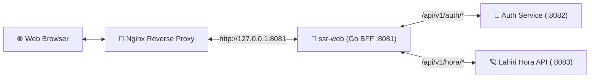

# 🔮 ssr-web — บูมบามเอไอ พยากรณ์ (Vedic Astrology BFF & SSR Gateway)

[](https://go.dev/)
[](LICENSE)
[](#โครงสร้างโปรเจกต์-project-layout)

**`ssr-web`** คือเซิร์ฟเวอร์ **BFF (Backend-For-Frontend)** และ **SSR Router Gateway** พัฒนาด้วยภาษา **Go (Golang)** สำหรับระบบทำนายดวงชะตาโหราศาสตร์พระเวท (Vedic Sidereal Lahiri / Whole Sign) **"บูมบามเอไอ พยากรณ์"**

---

## ✨ คุณสมบัติหลัก (Key Features)

- **⚡ Hybrid Asset Architecture**:
  - **Embedded Assets (`embed.FS`)**: ฝังไฟล์ HTML, JavaScript, Templates และฐานข้อมูลพิกัดอำเภอ/จังหวัดทั่วไทย (`district.json`) ไว้ใน RAM ของ Binary เสิร์ฟด้วยความเร็วระดับไมโครวินาที
  - **Disk Assets (`public/`)**: แยกไฟล์รูปภาพและไอคอน (`favicon.png`, `avatar.jpg`) ไว้บนดิสก์ เพื่อรักษาขนาด Binary ให้กะทัดรัดและเปลี่ยนรูปได้โดยไม่ต้อง Rebuild
- **🔐 Server-Side Authentication Guard**:
  - ตรวจสอบสิทธิ์ผ่าน `HttpOnly Cookie` (`auth_token`) กับ Auth Microservice ก่อนอนุญาตให้เข้าถึงหน้าห้องทำนาย (`/chat.html` และ `/transit.html`)
  - รองรับการตรวจสอบสถานะรหัสเชิญเข้าใช้งาน (`/api/v1/auth/serial-keys`) แบบเรียลไทม์
- **🪐 ระบบคำนวณและพยากรณ์โหราศาสตร์พระเวท (Lahiri Sidereal)**:
  - คำนวณตารางสมผุสดาว 27 นักษัตรฤกษ์ นวางศ์จักร (D-9) และวิมโสตรีทศา (Vimshottari Dasha)
  - พยากรณ์พื้นดวงชะตากำเนิดด้วย AI (`/hora/predict`) พร้อมระบบเรนเดอร์ Markdown ความเร็วสูงแบบ Zero-Dependency
  - พยากรณ์ดวงชะตาจร 12 เดือน ประจำปี พ.ศ. 2570 (`/transit.html`) แบบปลดล็อกเรียงตามลำดับเดือน (มกราคม – ธันวาคม 2570)
- **🛡️ Zero-Persistence Privacy & DOM XSS Protection**:
  - ข้อมูลส่วนตัวของผู้ใช้ (`user_username`, `user_birth_info`, `user_hora_result`, `user_predict_result`, `user_transit_2570`) จัดเก็บเฉพาะใน `sessionStorage` เท่านั้น และถูกล้างทิ้งทันทีเมื่อปิดแท็บหรือออกจากระบบ
  - ป้องกันช่องโหว่ DOM XSS 100% ด้วยการแยก HTML ออกเป็น `<template>` โหลดผ่าน `DOMParser` และผูกข้อมูลด้วย `textContent`
- **📝 Daily Log Rotation**:
  - หมุนไฟล์ Log รายวันอัตโนมัติลงใน `logs/app-YYYY-MM-DD.log` แบบ Dual Output (Console + File) พร้อมระบบลบไฟล์เก่าเกิน 7 วันในพื้นหลัง

---

## 🏛️ สถาปัตยกรรมระบบ (System Architecture)



---

## 📂 โครงสร้างโปรเจกต์ (Project Layout)

จัดระเบียบตามมาตรฐาน **Standard Go Project Layout** และ **Clean Architecture**:

```text
ssr-web/
├── .github/
│   ├── ISSUE_TEMPLATE/          # เทมเพลตแจ้ง Bug และขอเพิ่มฟีเจอร์บน GitHub
│   ├── PULL_REQUEST_TEMPLATE.md # เทมเพลตสำหรับเปิด Pull Request
│   └── workflows/
│       └── ci.yml               # GitHub Actions CI (Vet, Race Test, Build)
├── cmd/
│   └── server/
│       └── main.go              # Composition Root & Entrypoint ของ HTTP Server
├── internal/
│   ├── config/
│   │   └── config.go            # โหลดค่าตั้งต้นจาก .env และ Environment Variables
│   ├── handler/
│   │   ├── handler.go           # SSR Page Routing & Static/Public File Serving
│   │   ├── auth.go              # Auth Verification Guard, Cookie & Serial Key Proxy
│   │   ├── hora.go              # BFF Proxy เชื่อมต่อบริการ lahiri-api
│   │   ├── middleware.go        # HTTP Access Logging Middleware
│   │   └── handler_test.go      # Unit Tests & Parallel Load Benchmarks
│   └── logger/
│       ├── logger.go            # Daily Log Rotation & Auto-Cleanup (7 Days)
│       └── logger_test.go       # Unit Tests สำหรับระบบหมุนไฟล์ Log
├── public/                      # [Disk Assets] รูปภาพและ Favicon
│   ├── avatar.jpg
│   └── favicon.png
├── web/                         # [Embedded Assets] ฝังลง Binary ด้วย embed.FS
│   ├── embed.go                 # ประกาศ //go:embed
│   ├── index.html               # หน้าลงทะเบียนด้วย Username & Serial Key
│   ├── chat.html                # หน้าคำนวณสมผุสดาวและพยากรณ์พื้นดวงกำเนิด
│   ├── transit.html             # หน้าพยากรณ์ดวงชะตาจร 12 เดือน ประจำปี พ.ศ. 2570
│   └── static/
│       ├── auth.js              # ตรวจสอบสิทธิ์กับ Backend และจัดการ Logout
│       ├── hora-common.js       # Shared Domain, DOM & API Helpers
│       ├── login.js             # ลอจิกหน้าเข้าสู่ระบบและตรวจสอบสถานะ Serial Key
│       ├── district.js          # โหลดข้อมูลจังหวัด/อำเภอจาก district.json
│       ├── district.json        # ฐานข้อมูลพิกัดละติจูด/ลองจิจูดทั่วประเทศ
│       ├── birth.js             # รับข้อมูลวันเวลาเกิด แปลง พ.ศ./ค.ศ. และแสดงผลสรุป
│       ├── astrology.js         # คำนวณสมผุสดาวและพยากรณ์พื้นดวงชะตา
│       ├── transit.js           # พยากรณ์ดวงจร 12 เดือน ปี พ.ศ. 2570 แบบเรียงลำดับ
│       ├── result-template.html # HTML Template ข้อมูลสรุปวันเกิด
│       ├── astrology-template.html # HTML Template ตารางสมผุสดาวและคำพยากรณ์
│       └── transit-template.html   # HTML Template การ์ดพยากรณ์รายเดือน ปี พ.ศ. 2570
├── .env.example                 # ตัวอย่างไฟล์ตั้งค่าสภาพแวดล้อม
├── .gitattributes               # กำหนดมาตรฐาน Line Endings (LF)
├── .gitignore                   # รายการไฟล์ที่ไม่นำขึ้น Git
├── CONTRIBUTING.md              # แนวทางการมีส่วนร่วมพัฒนาโปรเจกต์
├── LICENSE                      # สัญญาอนุญาต Apache License 2.0
├── README.md                    # เอกสารหลักของโปรเจกต์
├── SECURITY.md                  # นโยบายด้านความปลอดภัยและความเป็นส่วนตัว
├── go.mod
├── go.sum
└── run.sh                       # สคริปต์สำหรับ Build, Run และ Benchmark บน Linux/WSL
```

---

## ⚙️ การติดตั้งและเริ่มต้นใช้งาน (Getting Started)

### 1. ความต้องการของระบบ (Prerequisites)
- **Go**: เวอร์ชัน `1.22` ขึ้นไป (แนะนำ `1.26+`)
- บริการต้นทาง (เมื่อรันครบระบบ):
  - `auth-service` (ค่าเริ่มต้นพอร์ต `8082`)
  - `lahiri-api` (ค่าเริ่มต้นพอร์ต `8083`)

### 2. การตั้งค่า Environment Variables (`.env`)
คัดลอกไฟล์ `.env.example` ไปเป็น `.env` และปรับค่าตามสภาพแวดล้อมของคุณ:

```bash
cp .env.example .env
```

| ตัวแปร | ค่าเริ่มต้น | คำอธิบาย |
| :--- | :--- | :--- |
| `PORT` | `8081` (fallback `6666`) | พอร์ตที่ `ssr-web` เปิดให้บริการ |
| `AUTH_SERVICE_URL` | `http://localhost:8082` | URL ของ Authentication Microservice |
| `HORA_SERVICE_URL` | `http://localhost:8083` | URL ของ Lahiri Vedic Astrology API |

### 3. คำสั่งรันและบิลด์ (Run & Build)

#### บน Windows (PowerShell / CMD)
```powershell
# คอมไพล์ Binary
go build -o server.exe ./cmd/server

# รันเซิร์ฟเวอร์
./server.exe
```

#### บน Linux / WSL / macOS (ผ่าน `run.sh`)
```bash
chmod +x run.sh

# คอมไพล์และรันโหมด Production Binary
./run.sh

# รันในโหมด Development (go run)
./run.sh dev

# คอมไพล์เฉพาะไฟล์ Binary (./ssr-web)
./run.sh build
```

---

## 🧪 การทดสอบและวัดประสิทธิภาพ (Testing & Benchmarks)

```bash
# รัน Unit Tests ทั้งหมด
go test -v ./...

# รัน Parallel Load Benchmarks วัดความเร็วและการใช้หน่วยความจำ
go test -v -bench=. -benchmem ./internal/handler
# หรือใช้สคริปต์:
./run.sh bench
```

---

## 🔌 สรุปเส้นทางให้บริการ (Routes & API Endpoints)

### SSR Web Pages
| Method | Path | การทำงาน |
| :---: | :--- | :--- |
| `GET` | `/`, `/index.html` | หน้าลงทะเบียนเข้าใช้งาน (หากมี Cookie `auth_token` จะ Redirect ไป `/chat.html`) |
| `GET` | `/chat.html` | หน้าคำนวณตารางสมผุสดาวและพยากรณ์พื้นดวงกำเนิด (ต้องผ่านการ Verify `auth_token`) |
| `GET` | `/transit.html` | หน้าพยากรณ์ดวงชะตาจร 12 เดือน พ.ศ. 2570 (ต้องมีข้อมูลพื้นดวงครบ 5 เงื่อนไข) |

### BFF API Proxy Endpoints
| Method | Path | ปลายทาง Upstream |
| :---: | :--- | :--- |
| `GET` | `/api/v1/auth/serial-keys`, `/auth/serial-keys` | ดึงสถานะรหัสซีเรียลทดสอบ (`ว่าง` / `ใช้แล้ว`) |
| `POST` | `/api/v1/hora/calculate`, `/hora/calculate` | คำนวณสมผุสดาว 27 นักษัตรฤกษ์ นวางศ์ และทศา |
| `POST` | `/api/v1/hora/dasha`, `/hora/dasha` | คำนวณเฉพาะวิมโสตรีทศา |
| `POST` | `/api/v1/hora/predict`, `/hora/predict` | พยากรณ์พื้นดวงชะตากำเนิดด้วย AI |
| `POST` | `/api/v1/hora/transitpredict_1` .. `12` | พยากรณ์ดวงชะตาจรรายเดือน (เดือนที่ 1 – 12) ประจำปี พ.ศ. 2570 |

---

## 📄 สัญญาอนุญาต (License)

โปรเจกต์นี้อนุญาตให้ใช้งานภายใต้สัญญาอนุญาต [Apache License 2.0](LICENSE)
